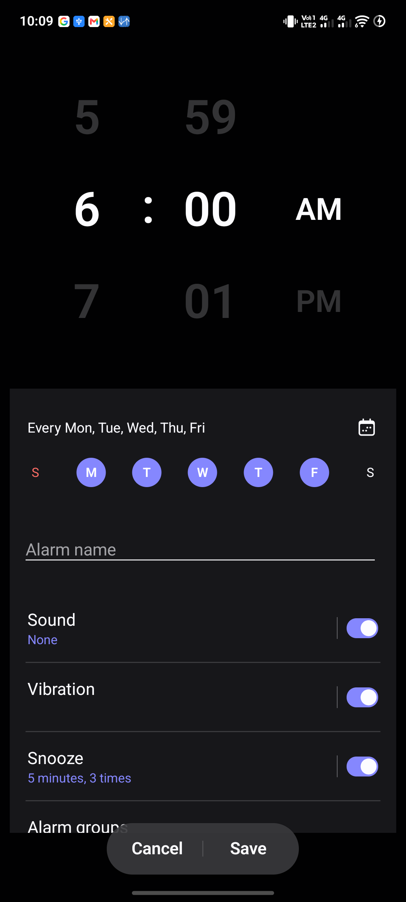
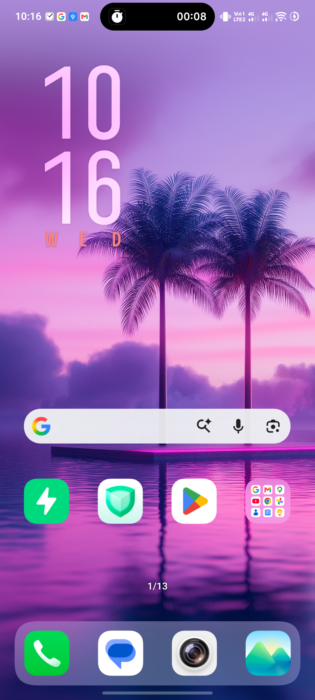

<div align="center">


# Samsung Clock (One UI 9 Port)

**Ported from a Samsung One UI 9 device to run smoothly on any Android 12+ (`API 31+`) smartphone.**

-3DDC84?style=flat-square&logo=android&logoColor=white)
-1428A0?style=flat-square)


</div>

---

## Overview

This repository hosts the **Samsung Clock (`com.sec.android.app.clockpackage` v12.5.60.27)** port extracted from One UI 9 and engineered with an AOSP compatibility bridge (`SemCompatBridge`, `SemAospBridge`, `SemClockTabAnimator`) so every section — **Alarm, World Clock, Stopwatch, and Timer** — runs natively and smoothly on **any Android 12–16 device** (Pixel, vivo OriginOS, Xiaomi HyperOS, Oppo ColorOS, OnePlus, Nothing, Motorola, AOSP ROMs, and Samsung devices).

## Key Features & Fixes

- **Universal Android 12+ (`minSdk 31`) Support**:
  - Safely backports Android 13–16 calls (`registerReceiver` export flags, `PendingIntent` options, `VibratorManager`, locale & notification helpers) via `SemCompatBridge`.
  - Provides AOSP implementations for missing Samsung framework classes (`FloatingFeature`, `SemCscFeature`, `SemWindowManager`, `SemDvfsManager`, `SemLog`, etc.).
- **Zero-Jank 120Hz Bottom-Tab & Fragment Transitions (`SemClockTabAnimator`)**:
  - Hardware-layer backed sliding + cubic-bezier transitions when switching between **Alarm**, **World Clock**, **Stopwatch**, and **Timer** without first-frame visual jolts or screen flicker.
  - Locks high refresh rate (`120Hz`) cleanly across `ClockPackage` and sub-activities.
- **Instant Alarm Edit Opening**:
  - Eliminates opening lag when tapping an existing alarm card (`AlarmEditActivity` & `AlarmListViewBase`) for snappy, immediate transition feedback.
- **Consistent World Clock Theming**:
  - Aligned World Clock background, surface card tones, and converter styling with the rest of One UI 9 Clock's light and dark palettes (`WorldclockViewHolder`, `WorldclockMainListAdapter`, `WorldclockUtils`).
- **Live Island / Promoted Ongoing Stopwatch Notifications**:
  - Includes Android 16 `POST_PROMOTED_NOTIFICATIONS` (`requestPromotedOngoing` / live-update chronometer) plus compatibility formatting so **Dynamic Island / Origin Island / Hyper Island / Live Alerts** capsules display live ticking stopwatch progress when leaving the app (`StopwatchNotificationService`).
- **Decoded Samsung `SPR` Drawables**:
  - Converted 20 proprietary Samsung `.bmp` (`SPR\0`) assets to render cleanly on non-Samsung devices.

## Screenshots

<p align="center">
  
  
  
  
</p>
<p align="center">
  
  
  
</p>

## Installation

1. Download **`SamsungClock-OneUI9.apk`** from the [GitHub Releases](../../releases) page (or from [`apk/SamsungClock-OneUI9.apk`](apk/SamsungClock-OneUI9.apk)).
2. Allow **Install unknown apps** if prompted by Android.
3. Install directly on any **Android 12+ (`API 31+`)** phone — **no root required**.
4. Grant **Alarms & Reminders**, **Notifications**, and **Full-screen / Battery optimization bypass** permissions so alarms ring reliably on screen-off and live stopwatch pills appear in your status bar / island.

## Repository Structure

```text
├── apk/                        # Ready-to-install patched Android 12+ APK
├── assets/                     # App icon and screenshots
├── modified_smali/             # Patched smali & manifest changes for Samsung Clock
├── scripts/                    # Android 12 compat auditor, smali patcher & AXML merger
└── shim/                       # Java compatibility layer (SemCompatBridge, SemAospBridge, SemClockTabAnimator, SprRenderer)
```

## Build & Patch Tooling

- [`scripts/audit_android12_compat.py`](scripts/audit_android12_compat.py) — Audits smali against Android SDK `api-versions.xml` for Android 12 compatibility.
- [`scripts/patch_android12_compat.py`](scripts/patch_android12_compat.py) — Rewrites Android 13–16 & Samsung proprietary calls to `SemCompatBridge` / `SemAospBridge`.
- [`scripts/patch_and_merge.py`](scripts/patch_and_merge.py) — Patches binary `AndroidManifest.xml` `minSdkVersion` (`31`) and injects the compiled shim DEX.

## Verification & Checksum

| Property | Value |
| :--- | :--- |
| **Package Name** | `com.sec.android.app.clockpackage` |
| **Version** | `12.5.60.27` (`1256027100`) |
| **Min SDK / Target SDK** | `31` (Android 12) / `36` (Android 16) |
| **APK Size** | `~57.87 MB` |
| **SHA-256** | `F1EA54933F5A5FBFCD217983200B48F2C5447BA07F3BB476DE04E269364148E6` |

## License

See [LICENSE](LICENSE).
