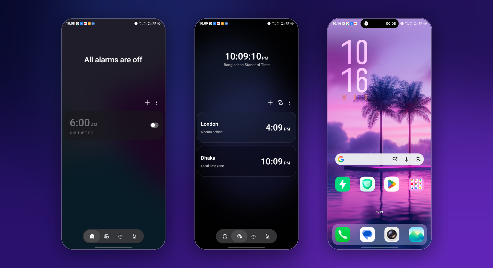
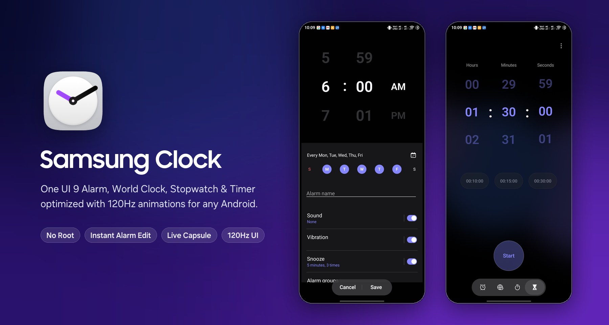

<h1>
  <picture>
    <source media="(prefers-color-scheme: dark)" srcset="assets/badges/title-dark.svg" />
    
  </picture>
</h1>

 

 

## Overview

**Samsung Clock** is ported from **Samsung One UI 9** (`v12.5.60.27`) and optimized to run cleanly across **all non-Samsung Android devices** on **Android 12 through Android 16+** without requiring root access.

In addition to removing Samsung system framework dependencies so Alarm, World Clock, Stopwatch, and Timer open crash-free, this port delivers **zero-jank 120Hz tab transitions**, **instant Alarm Edit sheet response**, **full dark/light World Clock parity**, and **live notification capsule updates** for active stopwatches and timers.

 

---

## Highlights

<table>
<tr>
<td width="33%" valign="top">

### 120Hz Smooth Navigation
- Hardware-layered cross-slide animation across all 4 Clock tabs
- Pre-draw layout gating prevents first-frame flicker on rapid taps
- Locked display refresh rate across Pixel, Vivo, Xiaomi, and Oppo

</td>
<td width="33%" valign="top">

### Alarms & Live Capsule
- Instant opening of the Alarm Edit sheet on card tap
- Background Stopwatch & Timer updates inside live status capsules
- Decoded Samsung sprite assets for alarm sounds and visuals

</td>
<td width="33%" valign="top">

### Theme & OEM Support
- Consistent contrast and surfaces across Light & Dark themes
- Works on Android 12–16+ with standard exact alarm permissions
- Clean universal signing with zero root or Magisk requirements

</td>
</tr>
</table>

---

## Status Legend

| Badge | Meaning |
| :--- | :--- |
|  | Works reliably on non-root Android 12–16+ devices. |
|  | Subject to Android OS exact-alarm or OEM power-off restrictions. |
|  | Depends on closed Samsung hardware or Galaxy companion firmware. |

---

## How Every Feature Works

| Feature | Status | How It Works on Non-Samsung Android |
| :--- | :---: | :--- |
| **Alarms & Repeating Schedules** |  | Schedules ringtones, vibration, and snooze cycles via standard Android `AlarmManager` exact alarm APIs. |
| **Instant Alarm Edit Sheet** |  | Eliminates main-thread lookup delays when tapping an alarm item so the edit screen slides up immediately. |
| **World Clock (Dark & Light)** |  | Maps city timezones locally using standard ICU timezone tables with full One UI card contrast fixes. |
| **Stopwatch & Live Capsule** |  | Publishes ongoing chronometer and live status notifications compatible with OriginOS Atomic Island, HyperOS, and AOSP status pills. |
| **Multi-Timers & Presets** |  | Runs concurrent countdown timers with audio alerts and customizable preset chips locally. |

---

## Compatibility and Limits

| Feature | Status | Technical Reason |
| :--- | :---: | :--- |
| **Power-Off Alarm Wake** |  | Booting a powered-off phone directly for an alarm requires OEM bootloader RTC hooks signed per device vendor. Alarms work normally whenever Android is awake or sleeping. |
| **Bixby Alarm Briefing** |  | Spoken weather/news briefing after alarm dismissal calls Samsung Bixby and Galaxy Weather system services absent on non-Samsung ROMs. |
| **Galaxy Watch Alarm Sync** |  | Wearable sync broadcasts rely on Samsung Wearable plugin daemons exclusive to Galaxy ecosystems. |

---

## Setup and Permissions

1. Download **`SamsungClock-OneUI9.apk`** from the [Latest Release](https://github.com/smartworldarafath/Samsung_Clock/releases/latest).
2. Install the APK and allow **Alarms & reminders** plus **Notifications** when prompted.
3. On Vivo OriginOS, Xiaomi HyperOS, or Oppo ColorOS, set Battery usage to **Unrestricted / Don't optimize** and enable **Autostart** so background alarms and live timers stay active overnight.
