<div align="center" id="overview">
  
  <br/>
  <picture><source media="(prefers-color-scheme: dark)" srcset="assets/readme/dark/hero-title.svg"></picture>
</div>

<p align="center">
  <a href="../../releases/latest"><picture><source media="(prefers-color-scheme: dark)" srcset="assets/readme/dark/btn-download.svg"></picture></a>
  <a href="#whats-been-fixed--engineered"><picture><source media="(prefers-color-scheme: dark)" srcset="assets/readme/dark/btn-engineering.svg"></picture></a>
  <a href="#screenshots"><picture><source media="(prefers-color-scheme: dark)" srcset="assets/readme/dark/btn-screenshots.svg"></picture></a>
  <a href="#build--patching-notes"><picture><source media="(prefers-color-scheme: dark)" srcset="assets/readme/dark/btn-patching.svg"></picture></a>
</p>

<p align="center">
  <picture><source media="(prefers-color-scheme: dark)" srcset="assets/readme/dark/badge-oneui.svg"></picture>
  <a href="../../releases/latest"><picture><source media="(prefers-color-scheme: dark)" srcset="assets/readme/dark/badge-version.svg"></picture></a>
  <picture><source media="(prefers-color-scheme: dark)" srcset="assets/readme/dark/badge-sdk.svg"></picture>
  <picture><source media="(prefers-color-scheme: dark)" srcset="assets/readme/dark/badge-noroot.svg"></picture>
  <a href="#whats-been-fixed--engineered"><picture><source media="(prefers-color-scheme: dark)" srcset="assets/readme/dark/badge-120hz.svg"></picture></a>
  <a href="#whats-been-fixed--engineered"><picture><source media="(prefers-color-scheme: dark)" srcset="assets/readme/dark/badge-island.svg"></picture></a>
  <a href="#whats-been-fixed--engineered"><picture><source media="(prefers-color-scheme: dark)" srcset="assets/readme/dark/badge-spr.svg"></picture></a>
</p>

<p align="center">
  <a href="#overview"><picture><source media="(prefers-color-scheme: dark)" srcset="assets/readme/dark/tab-overview.svg"></picture></a>
  <a href="#screenshots"><picture><source media="(prefers-color-scheme: dark)" srcset="assets/readme/dark/tab-screenshots.svg"></picture></a>
  <a href="#whats-been-fixed--engineered"><picture><source media="(prefers-color-scheme: dark)" srcset="assets/readme/dark/tab-engineering.svg"></picture></a>
  <a href="#installation"><picture><source media="(prefers-color-scheme: dark)" srcset="assets/readme/dark/tab-install.svg"></picture></a>
  <a href="#what-works--known-limitations"><picture><source media="(prefers-color-scheme: dark)" srcset="assets/readme/dark/tab-compat.svg"></picture></a>
  <a href="#build--patching-notes"><picture><source media="(prefers-color-scheme: dark)" srcset="assets/readme/dark/tab-build.svg"></picture></a>
  <a href="#build-metadata"><picture><source media="(prefers-color-scheme: dark)" srcset="assets/readme/dark/tab-metadata.svg"></picture></a>
</p>

---

Samsung's One UI 9 Clock doesn't run on non-Samsung phones out of the box. Aside from targeting Android 16 (`SDK 36`) and gating `minSdk` above older releases, the APK calls straight into Samsung's private framework JARs (`SemWindowManager`, `FloatingFeature`, `SemCscFeature`, `SemDvfsManager`, `SemLog`), relies on proprietary `SPR\0` drawables, and hits visual regressions when dropped onto AOSP-based ROMs — flat tab cuts, delayed alarm editing, mismatched World Clock colors, and background stopwatch pills that don't surface properly on other OEMs.

This port adapts **Samsung Clock `12.5.60.27`** to install and run smoothly on **any Android 12+ phone** (vivo OriginOS, Xiaomi HyperOS, Oppo ColorOS, OnePlus OxygenOS, Google Pixel, Nothing OS, custom AOSP ROMs, and Galaxy devices) without root.

<h2 id="screenshots"><picture><source media="(prefers-color-scheme: dark) and (max-width: 640px)" srcset="assets/readme/dark/hm-screenshots.svg"><source media="(prefers-color-scheme: dark)" srcset="assets/readme/dark/h-screenshots.svg"><source media="(max-width: 640px)" srcset="assets/readme/light/hm-screenshots.svg">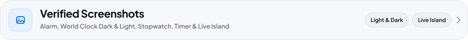</picture></h2>

<p align="center">
  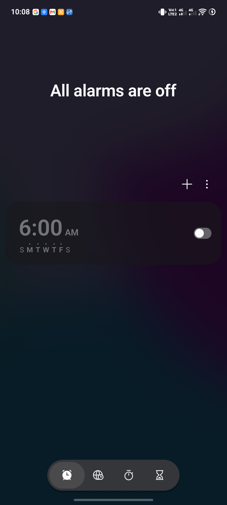
  
  
  
</p>
<p align="center">
  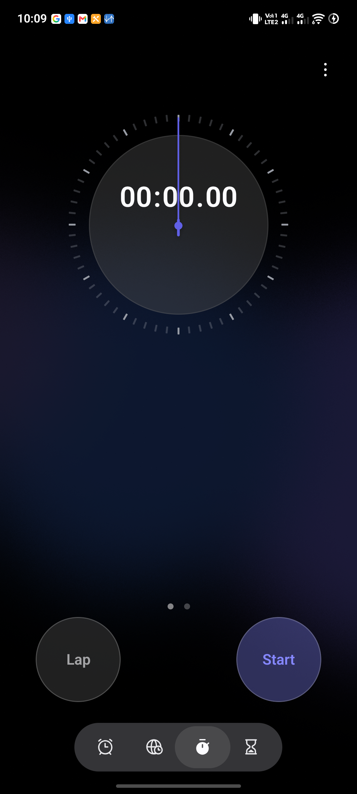
  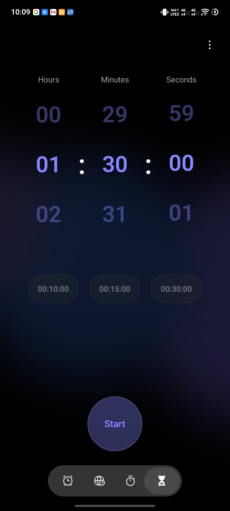
  
</p>

---

<h2 id="whats-been-fixed--engineered"><picture><source media="(prefers-color-scheme: dark) and (max-width: 640px)" srcset="assets/readme/dark/hm-engineering.svg"><source media="(prefers-color-scheme: dark)" srcset="assets/readme/dark/h-engineering.svg"><source media="(max-width: 640px)" srcset="assets/readme/light/hm-engineering.svg">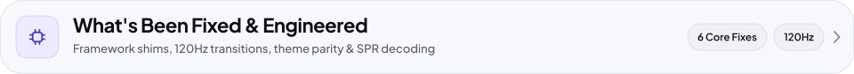</picture></h2>

<table width="100%">
  <tr>
    <td width="50%" align="center" valign="top">
      <picture><source media="(prefers-color-scheme: dark)" srcset="assets/readme/dark/card-shims.svg">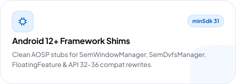</picture>
    </td>
    <td width="50%" align="center" valign="top">
      <picture><source media="(prefers-color-scheme: dark)" srcset="assets/readme/dark/card-animator.svg">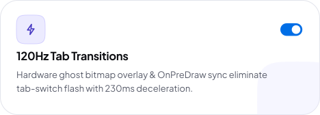</picture>
    </td>
  </tr>
  <tr>
    <td width="50%" align="center" valign="top">
      <picture><source media="(prefers-color-scheme: dark)" srcset="assets/readme/dark/card-alarm.svg">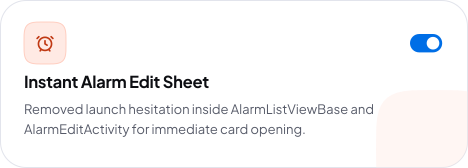</picture>
    </td>
    <td width="50%" align="center" valign="top">
      <picture><source media="(prefers-color-scheme: dark)" srcset="assets/readme/dark/card-worldclock.svg">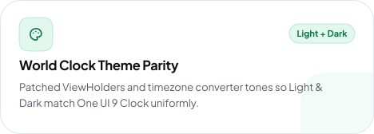</picture>
    </td>
  </tr>
  <tr>
    <td width="50%" align="center" valign="top">
      <picture><source media="(prefers-color-scheme: dark)" srcset="assets/readme/dark/card-island.svg">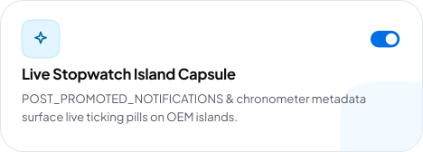</picture>
    </td>
    <td width="50%" align="center" valign="top">
      <picture><source media="(prefers-color-scheme: dark)" srcset="assets/readme/dark/card-spr.svg">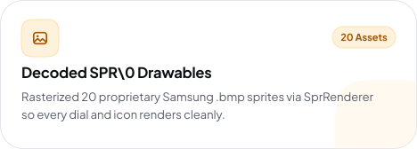</picture>
    </td>
  </tr>
</table>

### 1. Android 12+ (`minSdk 31`) & One UI Framework Compatibility
- **Framework stubs (`shim/src/`, `shim/outer_src/`)**: Provides clean AOSP implementations for missing Samsung system classes (`FloatingFeature`, `SemFloatingFeature`, `SemCscFeature`, `SemDvfsManager`, `SemWindowManager`, `SemStatusBarManager`, `SemBlurInfo`, `SmpsManager`, `ICoverManager`, and extended `Activity` / `ActivityManager` / `VibrationEffect` hooks).
- **Platform API backports (`SemCompatBridge`, `SemAospBridge`)**: Rewrites Android 13–16 calls (`registerReceiver` export flags, `PendingIntent` options, `VibratorManager`, locale helpers, window/display utilities) via `scripts/patch_android12_compat.py` after auditing smali against `android-36` `api-versions.xml`.
- **AXML manifest patch (`scripts/patch_and_merge.py`)**: Lowers `minSdkVersion` (`0x0101020c`) in binary `AndroidManifest.xml` directly to `31` and injects the compiled shim DEX.

### 2. Zero-Jank 120Hz Tab Transitions (`SemClockTabAnimator`)
In initial AOSP ports, switching between **Alarm**, **World Clock**, **Stopwatch**, and **Timer** either snapped abruptly with zero motion or flashed on the first frame while the incoming fragment laid out.

`SemClockTabAnimator` solves this at the view-container level:
- Captures a hardware bitmap snapshot (`activeGhostView`) of the outgoing tab inside the container's `ViewGroupOverlay`.
- Holds the incoming view via a single-shot `ViewTreeObserver.OnPreDrawListener` until layout is ready, eliminating the first-frame flash/jolt on rapid taps.
- Cross-slides both layers on hardware layers (`LAYER_TYPE_HARDWARE`) over `230ms` with a tight deceleration curve (`PathInterpolator(0.22f, 1.0f, 0.36f, 1.0f)`) and smooth `240ms` background easing, locked to your display's maximum refresh rate (`120Hz`).

### 3. Instant Alarm Edit Sheet
Fixed opening latency inside `AlarmListViewBase$setRecyclerViewItemClickListener$1` and `AlarmEditActivity` so tapping a scheduled alarm card opens the editor immediately instead of hesitating before starting the transition.

### 4. World Clock Color & Theme Consistency
Stock World Clock classes rendered with inconsistent surface and converter tones off-OneUI compared to Alarm, Stopwatch, and Timer. Patched `WorldclockViewHolder`, `WorldclockMainListAdapter`, `WorldclockTimezoneConverterViewHolder`, and `WorldclockUtils` so both **Dark Mode** and **Light Mode** match One UI 9 Clock's palette uniformly.

### 5. Background Stopwatch Live Capsule / Island Support
Modern OEM skins render active background timers/stopwatches inside pill/capsule overlays (**Origin Island**, **Hyper Island**, **Dynamic Island**, Android 16 **Live Updates**), which expect specific promoted-ongoing permissions and chronometer metadata.

- Added `android.permission.POST_PROMOTED_NOTIFICATIONS` to `AndroidManifest.xml`.
- Updated `StopwatchNotificationService.smali` and `SemCompatBridge` notification helpers so running the stopwatch and leaving the app surfaces a live ticking capsule/notification across supported ROMs rather than only a buried drawer notification.

### 6. Decoded Samsung `SPR\0` Drawables
20 `.bmp` UI assets inside Clock use Samsung's proprietary `SPR\0` image format instead of standard bitmap headers. These were rasterized using `SprRenderer.java` (`AssetManager` + `Resources` pipeline) so every icon, dial, and button state displays without missing assets on AOSP/third-party ROMs.

---

<h2 id="installation"><picture><source media="(prefers-color-scheme: dark) and (max-width: 640px)" srcset="assets/readme/dark/hm-install.svg"><source media="(prefers-color-scheme: dark)" srcset="assets/readme/dark/h-install.svg"><source media="(max-width: 640px)" srcset="assets/readme/light/hm-install.svg">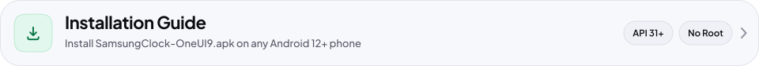</picture></h2>

1. Download **`SamsungClock-OneUI9.apk`** from [**Releases**](../../releases/latest) (or directly from [`apk/SamsungClock-OneUI9.apk`](apk/SamsungClock-OneUI9.apk)).
2. Enable **Install unknown apps** if prompted.
3. Install normally — **no root required** (`Android 12 / API 31` or newer).
4. Grant **Notifications** and **Alarms & Reminders** permissions on first launch, and set Battery usage for Samsung Clock to **Unrestricted** so background alarms and live stopwatch capsules aren't killed by aggressive OEM power savers (especially on vivo/Xiaomi/Oppo/Realme).

> [!NOTE]
> **Already on a Samsung One UI ROM?** Because this build uses a custom signature to allow universal installation outside Samsung's platform key, you cannot update directly on top of a stock system `com.sec.android.app.clockpackage` without first uninstalling/disabling the pre-installed system package.

---

<h2 id="what-works--known-limitations"><picture><source media="(prefers-color-scheme: dark) and (max-width: 640px)" srcset="assets/readme/dark/hm-compat.svg"><source media="(prefers-color-scheme: dark)" srcset="assets/readme/dark/h-compat.svg"><source media="(max-width: 640px)" srcset="assets/readme/light/hm-compat.svg">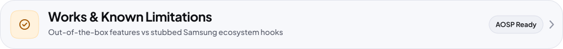</picture></h2>

- **Works out of the box**: Alarms (including vibration, ringtones, snooze, quick-edit), World Clock & timezone converter (light & dark), Stopwatch + Lap history + background island capsule, Timers + presets, 120Hz scrolling and tab transitions.
- **Not functional off-OneUI**: Samsung-ecosystem extras such as Galaxy Wearable / Watch alarm sync, Bixby alarm briefings, Samsung Weather background integration (`daemonapp`), and Samsung Keyboard / Modes & Routines deep-links are safely stubbed when those packages are absent.

---

<h2 id="build--patching-notes"><picture><source media="(prefers-color-scheme: dark) and (max-width: 640px)" srcset="assets/readme/dark/hm-build.svg"><source media="(prefers-color-scheme: dark)" srcset="assets/readme/dark/h-build.svg"><source media="(max-width: 640px)" srcset="assets/readme/light/hm-build.svg">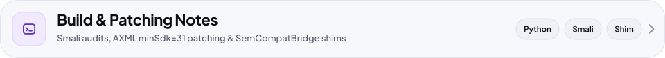</picture></h2>

```text
├── apk/SamsungClock-OneUI9.apk      # Signed, 16KB-zipaligned APK (v12.5.60.27)
├── assets/                          # Squircle icon & verified device screenshots
├── modified_smali/                  # Patched Clock smali files & AndroidManifest.xml
├── scripts/
│   ├── audit_android12_compat.py    # Audits smali against android-36 api-versions.xml
│   ├── patch_android12_compat.py    # Rewrites One UI / Android 13–16 calls to shims
│   ├── patch_and_merge.py           # Sets binary AXML minSdk=31 & injects shim DEX
│   └── map_spr.py                   # Extracts & maps Samsung SPR\0 asset IDs
└── shim/
    ├── SprRenderer.java             # Offline SPR -> PNG renderer
    ├── src/ & outer_src/            # Samsung & Android framework stubs
    └── src_bridge/com/samsung/shim/ # SemCompatBridge, SemAospBridge, SemClockTabAnimator
```

Set `SAMSUNG_PORT_BASE` to your workspace root before invoking `audit_android12_compat.py` or `patch_android12_compat.py` on a decompiled tree.

---

<h2 id="build-metadata"><picture><source media="(prefers-color-scheme: dark) and (max-width: 640px)" srcset="assets/readme/dark/hm-metadata.svg"><source media="(prefers-color-scheme: dark)" srcset="assets/readme/dark/h-metadata.svg"><source media="(max-width: 640px)" srcset="assets/readme/light/hm-metadata.svg">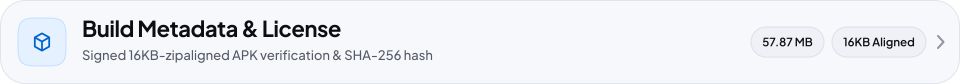</picture></h2>

| Field | Value |
| :--- | :--- |
| **Package** | `com.sec.android.app.clockpackage` |
| **Version** | `12.5.60.27` (`1256027100`) |
| **SDK Range** | `minSdk 31` (Android 12) · `targetSdk 36` (Android 16) |
| **APK Size** | `57.87 MB` (`60,686,065` bytes) |
| **SHA-256** | `F1EA54933F5A5FBFCD217983200B48F2C5447BA07F3BB476DE04E269364148E6` |

### License

Refer to [LICENSE](LICENSE). All original Samsung One UI assets and binaries remain the intellectual property of Samsung Electronics Co., Ltd.
